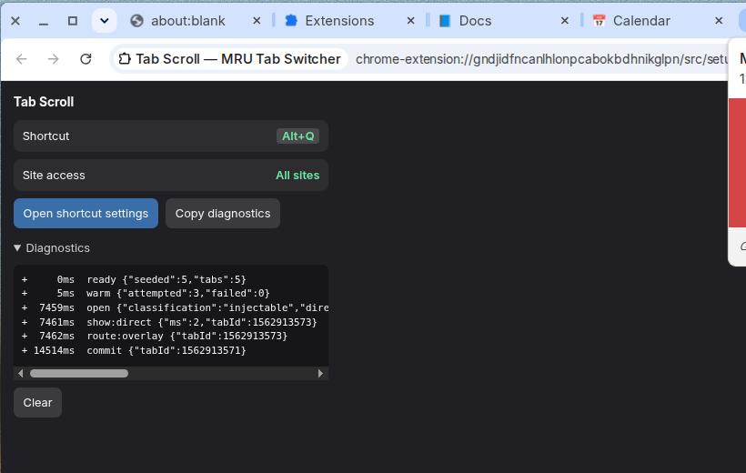

# Tab Scroll — MRU tab switcher for Chrome

Jump between recently used tabs with a thumbnail strip, in the spirit of Arc's
switcher and Firefox's "Ctrl+Tab cycles through tabs in recently used order".

Hold **Alt** (**Option** on macOS) and tap **Q**: a strip of your recent tabs
appears with a preview, title and favicon for each, with the tab you were just
on already highlighted. Keep the modifier down and tap **Q** again to move
along the strip, or **Shift+Q** to move back. **Letting go of the modifier
switches** to whatever is highlighted. A single press and release just jumps
back to the previous tab.


## Keys

| Key | Action |
| --- | --- |
| `Alt`+`Q` (hold `Alt`) | Open the strip |
| `Alt`+`Q` again / `Alt`+`Shift`+`Q` | Move the highlight forward / backward |
| Release `Alt` | Switch to the highlighted tab |

That is the whole interaction. There is no cancel: once the strip is open,
releasing the modifier always switches.

Both bindings are yours to change at `chrome://extensions/shortcuts`, and
release-to-commit follows whatever modifier you pick.

## First run: assign the shortcut

Chrome often declines to apply an extension's suggested shortcut, so it may
not be bound after installing. **Click the toolbar icon** — it shows whether a
shortcut is assigned and has a button that opens
`chrome://extensions/shortcuts`, where you assign one to **Show recent tabs**.
Extensions are not allowed to set their own shortcuts, so that page is
unavoidable; the popup just gets you there in one click.

The same popup shows whether site access is set to **On all sites**. If it is
limited to *on click*, the strip cannot be drawn on pages at all.



## Why Alt+Q and not Ctrl+Tab

Chrome does not let extensions bind `Tab` at all — it is not in the list of
keys the `chrome.commands` API accepts, and every binding must include Ctrl or
Alt. `docs/RESEARCH.md` walks through the evidence; the short answer is that
the literal Firefox gesture needs a browser fork, which is what Arc is.

Stepping with the hotkey letter rather than Tab also keeps the gesture working
everywhere: `Alt`+`Tab` belongs to the window manager on Windows and Linux,
whereas `Alt`+`Q` is delivered to the extension on every platform.

## Build

Requires Node 22.12 or newer (Vitest's floor).

```bash
npm ci
npm run build
```

The loadable extension is written to `dist/`.

| Script | What it does |
| --- | --- |
| `npm run dev` | Vite dev server with hot reload for the extension |
| `npm run build` | Production build into `dist/` |
| `npm test` | Unit tests (Vitest) |
| `npm run typecheck` | `tsc --noEmit` |
| `npm run lint` | ESLint |

## Load it in Chrome

1. Run `npm run build`.
2. Open `chrome://extensions`.
3. Turn on **Developer mode** (top right).
4. Click **Load unpacked** and pick the `dist/` folder in this repo.
5. Open a few tabs and visit each one, so there is a recent-tab order to show
   and so previews can be captured.
6. Hold **Alt** and tap **Q**.

To change the shortcut, go to `chrome://extensions/shortcuts` and edit
"Show recent tabs".

With `npm run dev` the extension reloads on save; you still load `dist/`
through **Load unpacked** the first time.

> Chrome 137 and later ignore the `--load-extension` command-line flag. If you
> are automating a browser rather than clicking through the UI, launch Chrome
> with `--enable-unsafe-extension-debugging --remote-debugging-port=<port>` and
> call the `Extensions.loadUnpacked` CDP command.

## How it works

```
src/
  background/      service worker — the only place that talks to chrome.tabs
    mru.ts           recency order, per window (pure, unit tested)
    tab-index.ts     cached tab metadata so a strip can be built with no awaits
    session.ts       selection, stepping and commit resolution (pure)
    shortcut.ts      reads the live binding to know which modifier commits
    thumbnails.ts    capture on activation, downscale to WebP, cache, evict
    geometry.ts      centres the fallback window on the browser window
    debug-log.ts     the ring buffer behind the popup's Diagnostics section
    index.ts         wires the above to Chrome's events
  content/
    overlay.ts       the strip, kept warm in a closed Shadow DOM
    keys.ts          what the hotkey letter and the modifier mean while open
    index.ts         content-script host
  setup/           the toolbar popup: shortcut status and diagnostics
  fallback/        the same strip in a popup window, for restricted pages
  shared/
    restricted.ts    classifies a URL as injectable, restricted or unknown
    types.ts         message and item types shared across contexts
```

Things worth knowing if you are changing it:

- **The strip is built once and kept warm.** The content script attaches the
  shadow root and its stylesheet at `document_start`; a keypress only fills in
  cards and unhides them.
- **The first message carries no thumbnails.** Titles and favicons paint
  immediately and previews arrive in a follow-up message.
- **Commit carries a tab id, not an index**, so the tab that gets switched to
  is always exactly the highlighted tile.
- **Every session has an epoch.** Messages from a previous session are ignored,
  so a stale overlay cannot act on the current one.
- **Previews are captured when you leave a tab, not when the strip opens.**
  `chrome.tabs.captureVisibleTab` can only photograph the visible tab, so a
  thumbnail shows the tab as you last saw it, and a tab you have not visited
  since installing shows a placeholder.
- **Thumbnails are painted into a canvas**, not an ``, because the strip
  lives in the page's document and strict sites restrict `img-src`.
- **MRU state is persisted**, because an MV3 service worker is evicted between
  events.

## Where it falls back

Chrome blocks content scripts on `chrome://*` pages, the Chrome Web Store and
the New Tab page. **Only those get the popup window.** An `http(s)` page never
does, however the injection goes — a window opening on top of an ordinary page
is worse than nothing. Tabs that were already open when the extension loaded
have the content script injected into them at install and at browser startup,
and again on demand if the first message finds nobody listening.

The window is centred on the browser window it belongs to, including on a
second monitor with negative coordinates.


Tabs that were already open before the extension was installed or reloaded get
the content script injected on demand, so they use the normal in-page overlay.

## Permissions

| Permission | Why |
| --- | --- |
| `tabs` | Read tab title, URL and favicon for the strip |
| `storage` | Cache MRU order and thumbnails in `chrome.storage.session` |
| `scripting` | Inject the overlay into tabs opened before the extension loaded |
| `<all_urls>` | Required by `captureVisibleTab` and to show the strip on any page |

Thumbnails and tab metadata stay in session storage on your machine and are
cleared when the browser closes. Nothing is sent anywhere.

## If it misbehaves: the diagnostics log

The switcher records every routing decision it makes — which tab, how the URL
was classified, whether the content script answered, how long an injection
retry waited, and which branch chose the overlay or the popup window.

**Click the toolbar icon, open Diagnostics, and press "Copy diagnostics".**
That puts the whole log on the clipboard along with the shortcut and site
access status; paste it into the issue. URLs are reduced to scheme and host
before they are recorded, so the log does not contain browsing history.

A healthy sequence looks like this:

```
+     0ms  ready {"seeded":5,"tabs":5}
+     5ms  warm {"attempted":3,"failed":0}
+  7459ms  open {"classification":"injectable","items":5,"url":"https://mail.google.com", ...}
+  7461ms  show:direct {"ms":2,"tabId":1562913573}
+  7462ms  route:overlay {"tabId":1562913573}
```

The lines worth reporting are `route:popup` on a page that is not a
`chrome://` page, `inject:failed` (usually site access limited to *on click*),
`show:timeout`, and `route:none`. The same lines appear live in the service
worker console, reachable from `chrome://extensions` → **service worker**.

## Known rough edges

- A tab never visited since the extension loaded has no preview; its favicon
  stands in until you next visit it.
- The fallback popup is a real window with a title bar, so on `chrome://`
  pages it is visibly slower than the in-page strip and steals focus. Chrome
  gives extensions no way to make it chromeless.
- If focus leaves the page mid-gesture the modifier release never arrives; the
  strip resolves by switching to whatever was highlighted, since there is no
  cancel path.

## Licence

MIT — see [LICENSE](LICENSE).
