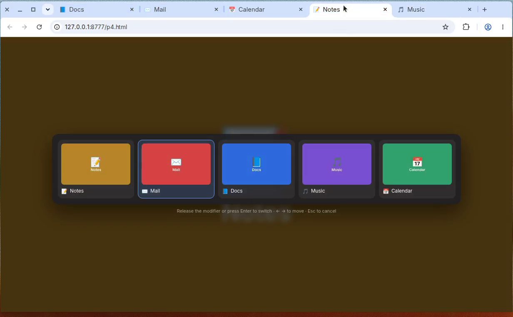
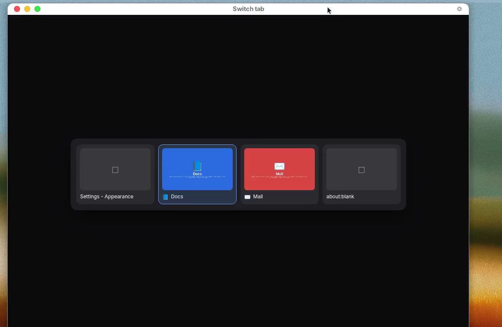

# Tab Scroll — MRU tab switcher for Chrome

Jump between recently used tabs with a thumbnail strip, the way Arc's switcher
and Firefox's "Ctrl+Tab cycles through tabs in recently used order" work.

Hold **Alt** and tap **Q**: a strip of your recent tabs appears with a preview,
title and favicon for each. Keep tapping Q to move along it, and **let go of
Alt to switch**. One quick press-and-release jumps straight back to the tab you
were just on.



## Why Alt+Q and not Ctrl+Tab

Chrome does not let extensions bind `Tab` at all — it is not in the list of
keys the `chrome.commands` API accepts, and every binding must include Ctrl or
Alt. Taking Shift+Tab inside the page instead would break reverse focus
traversal on every site. `docs/RESEARCH.md` walks through the evidence and the
alternatives; the short answer is that the literal Firefox gesture needs a
browser fork, which is what Arc is.

The binding is yours to change at `chrome://extensions/shortcuts`, and
release-to-commit follows whatever modifier you pick.

## Keys

| Key | Action |
| --- | --- |
| `Alt+Q` | Open the strip / move forward |
| `Alt+Shift+Q` | Open the strip / move backward |
| Release `Alt` | Switch to the selected tab |
| `Enter` or `Space` | Switch to the selected tab |
| `←` `→` or `Tab` / `Shift+Tab` | Move the selection (only while the strip is open) |
| `Esc`, or a click outside the strip | Cancel |
| Click a card | Switch to that tab |

## Build

Requires Node 22.12 or newer (Vitest's floor).

```bash
npm ci
npm run build
```

The loadable extension is written to `dist/`.

| Script | What it does |
| --- | --- |
| `npm run dev` | Vite dev server with hot reload for the extension |
| `npm run build` | Production build into `dist/` |
| `npm test` | Unit tests (Vitest) |
| `npm run typecheck` | `tsc --noEmit` |
| `npm run lint` | ESLint |

## Load it in Chrome

1. Run `npm run build`.
2. Open `chrome://extensions`.
3. Turn on **Developer mode** (top right).
4. Click **Load unpacked** and pick the `dist/` folder in this repo.
5. Open a few tabs and visit each one, so there is a recent-tab order to show
   and so previews can be captured.
6. Hold **Alt** and tap **Q**.

To change the shortcut, go to `chrome://extensions/shortcuts` and edit
"Show recent tabs / move forward through them".

With `npm run dev` the extension reloads on save; you still load `dist/`
through **Load unpacked** the first time.

> Chrome 137 and later ignore the `--load-extension` command-line flag. If you
> are automating a browser rather than clicking through the UI, launch Chrome
> with `--enable-unsafe-extension-debugging --remote-debugging-port=<port>` and
> call the `Extensions.loadUnpacked` CDP command.

## How it works

```
src/
  background/      service worker — the only place that talks to chrome.tabs
    mru.ts           recency order, per window (pure, unit tested)
    session.ts       selection / cycling / commit state (pure, unit tested)
    shortcut.ts      reads the live binding to know which modifier commits
    thumbnails.ts    capture on activation, downscale, cache, evict
    index.ts         wires the above to Chrome's events
  content/
    overlay.ts       the strip, rendered into a closed Shadow DOM
    keys.ts          what each key means while the strip is open (pure)
    index.ts         content-script host
  fallback/        the same strip in a popup window, for restricted pages
  shared/types.ts  message and item types shared across contexts
```

A few things worth knowing if you are changing it:

- **Previews are captured when you leave a tab, not when the strip opens.**
  `chrome.tabs.captureVisibleTab` can only photograph the visible tab, so a
  thumbnail shows the tab as you last saw it. A tab you have not visited since
  installing shows a placeholder.
- **MRU state is persisted on every change.** An MV3 service worker is evicted
  between events, so nothing may live only in memory.
- **Order is tracked per window**, and `windows.onFocusChanged` promotes the
  newly focused window's active tab.
- **Selection starts at index 1**, because index 0 is the tab you are on.

## Where it falls back

Chrome blocks content scripts on `chrome://*` pages, the Chrome Web Store and
the New Tab page. There the strip opens in a small focused popup window
instead. Same strip, same keys, but it is a separate OS window, so it is
slower and takes focus.



Tabs that were already open before the extension was installed or reloaded get
the content script injected on demand, so they use the normal in-page overlay.

## Permissions

| Permission | Why |
| --- | --- |
| `tabs` | Read tab title, URL and favicon for the strip |
| `storage` | Cache MRU order and thumbnails in `chrome.storage.session` |
| `scripting` | Inject the overlay into tabs opened before the extension loaded |
| `<all_urls>` | Required by `captureVisibleTab` and to show the strip on any page |

Thumbnails and tab metadata stay in session storage on your machine and are
cleared when the browser closes. Nothing is sent anywhere.

## Known rough edges

- A tab never visited since install has no preview, only a placeholder.
- The fallback popup is a real window, so it is visibly slower than the
  in-page strip and steals focus.
- If the page cannot see the modifier release — for example focus moves to
  browser chrome mid-gesture — the strip cancels itself after a few seconds
  rather than switching. `Enter` always commits.

## Licence

MIT — see [LICENSE](LICENSE).
